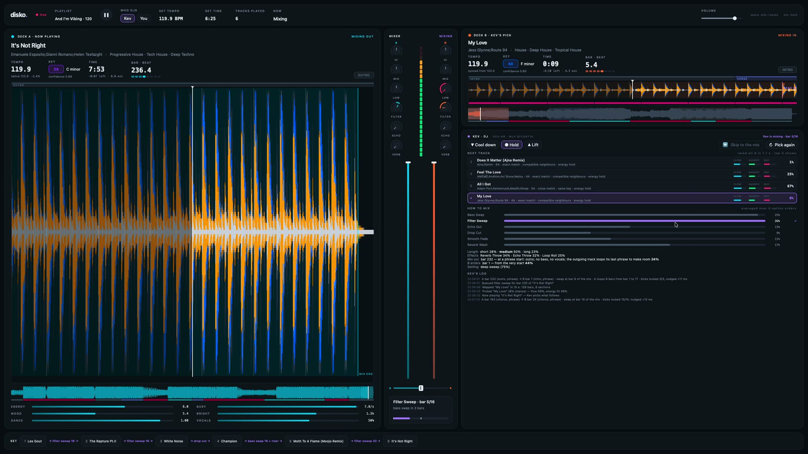

# disko

An AI DJ for your own music. Point it at a folder of tracks and pick the first song. From then on, Kev, a local [System One](https://systemonemodels.org/) decision model, chooses each next track and how to mix into it. Ordinary code analyses the audio, keeps Kev's options valid, and renders beatmatched transitions that land on phrase starts.

[](docs/demo.mp4)

▶ **[Watch the one-minute demo](docs/demo.mp4)** (with sound). Six tracks into a set, Kev picks "My Love" and mixes out of "It's Not Right" with a filter sweep, starting on the outro phrase at bar 232.

## How it works

1. **Fast pass, when you open a folder.** Essentia reads every track in 12 parallel processes, about 0.6 s each: tags, tempo and beats, key, loudness, and pretrained models for style, danceability, vocals, arousal and valence. Results are saved in `<folder>/disko/`, so a folder is only indexed once.
2. **Deep pass, just before a track plays.** [allin1](https://github.com/mir-aidj/all-in-one) (its MLX port) finds beats, downbeats and labelled sections, and splits the track into stems for per-bar vocal and bass levels. It runs on the opener you pick and on each track Kev picks, 8–28 s per track, while the current one is still playing.
3. **Kev decides.** Code scores every unplayed track against the current one (tempo, key, energy, vibe, genre) and shortlists eight. Kev rates them and the app samples a pick. Kev then chooses the technique, the overlap length, the mix-out and mix-in points, and the technique's setting. From the 5th track on it can also stack effects. Every option it sees is one the engine can actually play.
4. **The engine renders.** Each transition is rendered offline as soon as it's queued, so the audio callback only copies samples. Deck B is time-stretched to the set tempo and nudged until the kicks lock. Cues snap to phrase starts taken from allin1's sections.

### Techniques and effects

| Technique | What happens |
|---|---|
| Bass Swap | Both tracks play together; the basslines trade places on a downbeat. |
| Filter Sweep | The outgoing track is high-passed away while the incoming one opens up. |
| Echo Out | The outgoing track is thrown into an echo; the new one drops in on the beat. |
| Drop Cut | A hard cut on the downbeat, for a big jump in energy. |
| Smooth Fade | A plain crossfade with no EQ tricks, for breakdowns and calm tracks. |
| Reverb Wash | The outgoing track swells into a reverb that washes over the new one's start. |

Effects sit on top of a technique, at most two per mix: **Riser**, **Loop Roll**, **Echo Throw** and **Reverb Throw**. When a blend doesn't fit before the outgoing track ends, **Loop Extend** loops its last vocal-free phrase to make room.

## Running it

On an Apple Silicon Mac or x86_64 Linux, with [uv](https://docs.astral.sh/uv/) installed:

```bash
./scripts/setup.sh --kev-weights   # once: the venvs, Kev and its weights, the Essentia models
bin/disko                          # open the app
bin/disko app --install            # macOS, optional: disko.app in ~/Applications, for the Dock
```

On Linux, install PortAudio, a C compiler and git first (Debian/Ubuntu: `sudo apt-get install libportaudio2 build-essential git`); setup checks for them and names the packages for your distribution.

`bin/disko doctor` checks that every piece is in place and prints the command that fixes what isn't. `bin/disko help` lists the rest: `bin/disko headless FOLDER` plays a folder with no window, and `bin/disko ctl status` (or `start`, `pause`, `energy up`, ...) steers a running set. To type just `disko`, link it onto your PATH: `ln -s "$PWD/bin/disko" ~/.local/bin/disko`.

disko.app is a launcher for this checkout, not a standalone copy. It runs `.venv-live` from here, and the checkout's path is fixed when the app is built, so rebuild it (`bin/disko app --install`) after moving the checkout. It logs to `~/Library/Logs/disko.log`.

The app opens on a welcome screen. Choose or drop a playlist folder, wait for the fast pass, then pick an opening track. Kev takes over from there.

- **Who DJs:** Kev, or You to pick the next track and plan the mix yourself.
- **Cool down / Hold / Lift** steers the energy of Kev's next pick.
- **Skip to the mix** jumps to 8 bars before the queued transition; **Pick again** asks Kev for another track.
- **Space** plays and pauses; **Esc** goes back.

Other ways in (`bin/disko` takes the same flags, e.g. `bin/disko --playlist ~/Music/set`):

```bash
.venv-live/bin/python -m live --playlist ~/Music/set
```

```bash
.venv-live/bin/python -m live --snapshot out.png --scenario mix
```

The first skips the welcome screen. The second renders the window offscreen to a PNG with no sound; `--scenario` takes `welcome`, `indexing`, `start`, `browse`, `plan`, `queued`, `mix`, `after`, `kev`, `kevmix` or `kevafter`. `--house` uses the house test set in `data/house` instead of a playlist.

### Controlling a set from elsewhere

While disko is open it takes commands on a local socket (`--no-control` turns that off). Run it without a window with `disko headless DIR`, and steer either from a terminal or from Hermes:

```bash
bin/disko headless ~/Music/set
bin/disko ctl start
bin/disko ctl energy up
bin/disko ctl status
```

The control socket lives in `~/.disko`, readable only by you, and disko only answers a process running as the same user. Nothing listens on the network unless you pass `--control-tcp HOST:PORT`, which needs the token disko then writes to `~/.disko/control.token`. Each start also records where disko is installed in `~/.disko/install.json`, so the Hermes plugin ([hermes-disko](https://github.com/emirkaan5/hermes-disko)) can open disko for you; the copy in `integrations/hermes/disko` is the older draft it replaced. `python -m live --fake 12` runs everything on a synthetic catalog with no real music.

### Beatport

disko can sign in to Beatport and read your playlists, Beatport charts and catalog metadata (tempo, Camelot key, genre, length). With an active Beatport Streaming plan it can also play tracks: set `DISKO_BEATPORT_STREAMING=1` and a track's audio comes from Beatport's streaming endpoint and is decoded through ffmpeg in memory. Without that plan disko browses only. See `BEATPORT_INTEGRATION_PLAN.md`.

It needs two things:

1. **disko's own client ID**, issued by Beatport with `http://127.0.0.1:8765/callback` registered as its redirect URI. Put it in a `.env` file at the repository root. git ignores `.env`, and `.env.example` shows the format:

   ```bash
   cp .env.example .env && chmod 600 .env
   ```

   Then set `DISKO_BEATPORT_CLIENT_ID` (and `DISKO_BEATPORT_CLIENT_SECRET` if Beatport gave you one). Alternatively, `python -m live.sources.beatport set-client` stores them in the Keychain; the `.env` values win if both are set. Sign-in tokens always go in the Keychain.

   Beatport's docs page has its own client ID, which some community tools copy. disko refuses it unless you set `DISKO_BEATPORT_ALLOW_BORROWED_CLIENT=1`, which is only meant for trying the system before a real client ID arrives. That client registers no loopback callback, so `login` sends the browser to the docs client's own `https://api.beatport.com/v4/auth/o/post-message/` redirect instead, and `login --no-browser` prints the link and asks you to paste the code back (grab it from the redirect with your browser's DevTools, Network tab, "Preserve log" on).
2. **A sign-in:**

   ```bash
   .venv-live/bin/python -m live.sources.beatport login
   ```

   With a borrowed client ID, use `login --no-browser` and paste the code when asked.

Then:

```bash
.venv-live/bin/python -m live.sources.beatport status
.venv-live/bin/python -m live.sources.beatport playlists
.venv-live/bin/python -m live.sources.beatport tracks my:123
.venv-live/bin/python -m live.sources.beatport track 17606729 --raw
.venv-live/bin/python -m live.sources.beatport logout
```

disko uses Beatport for browsing, track details and passing those details to Kev on your computer. To restrict that, add `live/sources/capabilities/beatport.json` (the format is in `live/sources/policy.py`); if the file exists, it replaces the default. `DISKO_BEATPORT_STREAMING=1` widens the default to allow decoding, analyzing and mixing the stream.

To play a set from a Beatport list (needs the streaming plan), pass it to `live`:

```bash
DISKO_BEATPORT_STREAMING=1 .venv-live/bin/python -m live --beatport chart:1234
```

The v4 docs don't show response formats, so check the field mapping (`track_info` in `live/sources/beatport/source.py`) against the `--raw` output from your first real call. `tests/fake_beatport.py` is the stand-in server the tests use. Run it on its own and pass its address with `--api` to try the commands without Beatport.

### Spotify

disko can sign in to Spotify with your own developer app, list your playlists and Liked Songs, and read a track's metadata, ISRC and market availability. It carries no tempo or key, so what a track sounds like is measured instead: a 30 s preview of every track in the playlist makes the pool, and the whole track is fetched and analysed only when it is about to play. See `SPOTIFY_INTEGRATION_PLAN.md`.

Browsing needs one thing: **your own client ID**, from a Spotify developer app with `http://127.0.0.1:8766/callback` registered as its redirect URI. Paste it on the window's Spotify page, or, since it is not a secret, put it in the environment or the Keychain from a terminal:

```bash
.venv-live/bin/python -m live.sources.spotify set-client        # stores it in the Keychain
.venv-live/bin/python -m live.sources.spotify login             # opens the browser
.venv-live/bin/python -m live.sources.spotify playlists
.venv-live/bin/python -m live.sources.spotify tracks liked --limit 50
```

To play a set from one of them, pass the playlist to `live` (an id, a link or `liked`):

```bash
.venv-live/bin/python -m live --spotify liked --spotify-limit 50
```

That only works once you have turned Spotify audio on, in the window's Spotify page or with `audio on`, after reading what it means; there is no other switch, no environment variable and no capability matrix that can turn it on. Audio then comes through librespot, an unofficial client, which is **against Spotify's terms of service** whatever plan the account holds: the account could be suspended, and it can stop working without notice. The switch is off until you turn it on yourself, and signing out clears it. Turning it on in the window also sets it up there: disko builds the fetcher's own venv (`.venv-spotify`, `requirements/spotify.txt`, which brings a static ffmpeg) with uv, then opens librespot's own sign-in in the browser. `scripts/setup.sh --spotify-audio` and `.venv-spotify/bin/python live/workers/spotify_fetch.py --login` do the same from a terminal. Nothing is recorded or exported, and decoded audio lives only in the session's temp folder.

Nothing here has been run against a real Spotify account yet. The first run, step by step, with what each step should print and what a failure at that step means, is the checklist at the end of `SPOTIFY_INTEGRATION_PLAN.md`; write what you saw into its "Real run results".

`tests/fake_spotify.py` is the stand-in server the tests use, `tests/fake_previews.py` stands in for the preview sources, and `tests/stub_workers/spotify_fetch.py` stands in for librespot. No test touches Spotify.

## Setup

disko runs on Apple Silicon Macs and on x86_64 Linux. It needs [uv](https://docs.astral.sh/uv/) (`curl -LsSf https://astral.sh/uv/install.sh | sh`); ffmpeg (`brew install ffmpeg`, or your distribution's package) is optional and only used for AAC/M4A files, Beatport streams and a fetched Spotify track. Then:

```bash
./scripts/setup.sh                 # or: bin/disko setup
```

It sets up whatever is missing and leaves the rest alone, so it is safe to run again. It finishes by running `bin/disko doctor`. Options:

- `--dry-run` prints every step it would take and changes nothing.
- `--kev-weights` also downloads Kev's weights (several GB, once). Without it, setup prints the command.
- `--spotify-audio` also builds the fetcher's venv (`.venv-spotify`, `requirements/spotify.txt`). Nothing uses it unless you turn Spotify audio on, and it is left out otherwise.
- `--upgrade` re-installs the requirements into venvs that already exist. It never deletes a venv.

What it does, which is also how to do it by hand:

**Venvs.** disko uses Python 3.14 with one venv per job, because essentia-tensorflow clashes with plain essentia. Each venv's packages are listed in `requirements/`, and setup creates any venv that is missing:

```bash
uv venv .venv-live --python 3.14 && uv pip install --python .venv-live -r requirements/live.txt
```

| Venv | Used for | Requirements | Main packages |
|---|---|---|---|
| `.venv-live` | The app | `requirements/live.txt` | pyside6, sounddevice, pedalboard, numba, scipy, soundfile, soxr, pandas, httpx |
| `.venv-essentia-tf` | Fast pass | `requirements/fast.txt` | essentia-tensorflow |
| `.venv-audio` | Deep pass, house-set scripts | `requirements/audio.txt` | all-in-one-mlx (macOS) or allin1 and torch (Linux), demucs, essentia, librosa |
| `.venv` | Benchmarks (not set up by setup.sh) | | laya, httpx, torch |

`DISKO_FAST_PYTHON` and `DISKO_DEEP_PYTHON` point the app at other interpreters for the two passes.

**On Linux.** The same three venvs, with two differences:

- The deep pass runs upstream [allin1](https://github.com/mir-aidj/all-in-one) on PyTorch instead of its MLX port, and Kev runs on PyTorch too. Both use an NVIDIA GPU when there is one (setup installs the matching torch build with `uv pip install --torch-backend auto`) and the CPU otherwise, where a track's deep pass takes a few minutes. allin1 expects NATTEN 0.14's API, which current NATTEN releases no longer have; `live/workers/natten_torch` is a small PyTorch stand-in for the four functions it calls, so NATTEN isn't installed. `tests/test_natten_torch.py` checks it against natten-mlx, and on a real track it gives the same beats, downbeats and sections as the MLX port.
- Sign-in tokens (Beatport, Spotify, a Jev API key) go to the desktop keyring (GNOME Keyring or KWallet, through the Secret Service) instead of the macOS Keychain. With no keyring running, signing in fails with a message; disko never writes tokens to a file.

Linux needs PortAudio for sound, a C compiler (the deep pass builds [madmom](https://github.com/CPJKU/madmom) from a pinned commit) and git. arm64 Linux isn't supported, because essentia-tensorflow (the fast pass) has no build for it. It also needs glibc 2.34 or newer (Ubuntu 22.04+, Debian 12+, Fedora 35+): PySide6 publishes Linux wheels for nothing older. There's no Dock app; link `bin/disko` onto your PATH instead.

**Kev.** Setup clones [jaredpalmer/kev](https://github.com/jaredpalmer/kev) into `external/kev` and builds its environment with `uv sync --extra serve`. When no server is running, the app starts Kev-4B on port 8009 and stops it again on exit. It starts it offline, though, so the weights must already be in the Hugging Face cache. `--kev-weights` fetches them by running the server once until it answers; by hand, run this and press Ctrl-C once it is serving:

```bash
cd external/kev && uv run --extra serve python -m kev.serve --run jaredpalmer/kev-4b --port 8009
```

`KEV_URL` and `KEV_RUN` choose a different server or checkpoint.

**Essentia models.** Setup downloads the `.pb` and `.json` files for these models from [essentia.upf.edu/models](https://essentia.upf.edu/models/) into `data/house/models/essentia/`, where the fast pass reads them: `discogs-effnet-bs64-1`, `msd-musicnn-1`, `genre_discogs400-discogs-effnet-1`, `danceability-discogs-effnet-1`, `voice_instrumental-discogs-effnet-1` and `emomusic-msd-musicnn-2`. They're CC BY-NC-SA, so non-commercial use only.

## Repository

| Path | What's there |
|---|---|
| `live/` | The app: analysis workers, Kev's decisions (`dj.py`), techniques and effects (`mixes.py`), DSP and the audio engine, and the PySide6 UI |
| `bin/disko` | The one command: the app, `headless`, `ctl`, `setup`, `app` and `doctor` |
| `scripts/setup.sh` | Sets up the venvs, Kev and the Essentia models; safe to run again |
| `requirements/` | Each venv's packages |
| `scripts/make_app.sh`, `scripts/make_icon.py` | Build `dist/disko.app` and its icon |
| `scripts/render_mix.py` | Renders one transition to a WAV for listening |
| `scripts/audit_cues.py` | Counts how many cue points land on a phrase start |
| `scripts/house/` | Builds the house test set: 568 Creative Commons tracks from FMA and MTG-Jamendo, fully analysed |
| `data/house/` | That set's track table (`tracks.csv`) and column dictionary; the audio itself isn't committed |
| `bench/` | The Raveform timing test: can a System One model predict where real DJs mixed? |
| `results/` | Benchmark summaries |
| `PLAN.md` | The full design: architecture, decisions, techniques, roadmap and open questions |

### What the benchmark found

Before building the app, `bench/timing_test.py` asked Kev and Laya, zero-shot, to predict from track structure alone where real DJs mixed, using transitions from the Raveform dataset. On the test folds Kev scored 31% and Laya 26%, against 39% for always giving the most common answer. So in the app, code does the measuring and narrows every decision to a few valid options before Kev chooses.
