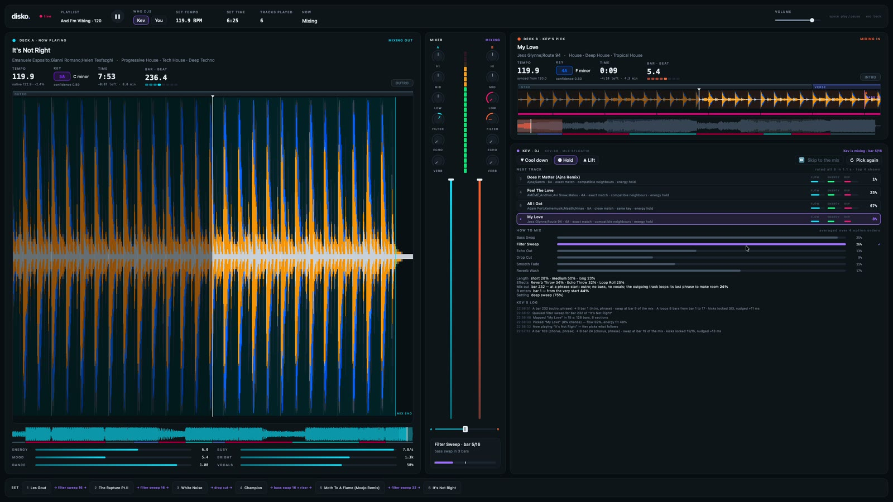

# disko

An AI DJ for your own music. Point it at a folder of tracks and pick the first song. From then on, Kev, a local [System One](https://systemonemodels.org/) decision model, chooses each next track and how to mix into it. Ordinary code analyses the audio, keeps Kev's options valid, and renders beatmatched transitions that land on phrase starts.

[](docs/demo.mp4)

▶ **[Watch the one-minute demo](docs/demo.mp4)** (with sound). Six tracks into a set, Kev picks "My Love" and mixes out of "It's Not Right" with a filter sweep, starting on the outro phrase at bar 232.

## How it works

1. **Fast pass, when you open a folder.** Essentia reads every track in 12 parallel processes, about 0.6 s each: tags, tempo and beats, key, loudness, and pretrained models for style, danceability, vocals, arousal and valence. Results are saved in `<folder>/disko/`, so a folder is only indexed once.
2. **Deep pass, just before a track plays.** [allin1](https://github.com/mir-aidj/all-in-one) (its MLX port) finds beats, downbeats and labelled sections, and splits the track into stems for per-bar vocal and bass levels. It runs on the opener you pick and on each track Kev picks, 8–28 s per track, while the current one is still playing.
3. **Kev decides.** Code scores every unplayed track against the current one (tempo, key, energy, vibe, genre) and shortlists eight. Kev rates them and the app samples a pick. Kev then chooses the technique, the overlap length, the mix-out and mix-in points, and the technique's setting. From the 5th track on it can also stack effects. Every option it sees is one the engine can actually play.
4. **The engine renders.** Each transition is rendered offline as soon as it's queued, so the audio callback only copies samples. Deck B is time-stretched to the set tempo and nudged until the kicks lock. Cues snap to phrase starts taken from allin1's sections.

### Techniques and effects

| Technique | What happens |
|---|---|
| Bass Swap | Both tracks play together; the basslines trade places on a downbeat. |
| Filter Sweep | The outgoing track is high-passed away while the incoming one opens up. |
| Echo Out | The outgoing track is thrown into an echo; the new one drops in on the beat. |
| Drop Cut | A hard cut on the downbeat, for a big jump in energy. |
| Smooth Fade | A plain crossfade with no EQ tricks, for breakdowns and calm tracks. |
| Reverb Wash | The outgoing track swells into a reverb that washes over the new one's start. |

Effects sit on top of a technique, at most two per mix: **Riser**, **Loop Roll**, **Echo Throw** and **Reverb Throw**. When a blend doesn't fit before the outgoing track ends, **Loop Extend** loops its last vocal-free phrase to make room.

## Running it

```bash
.venv-live/bin/python -m live
```

The app opens on a welcome screen. Choose or drop a playlist folder, wait for the fast pass, then pick an opening track. Kev takes over from there.

- **Who DJs:** Kev, or You to pick the next track and plan the mix yourself.
- **Cool down / Hold / Lift** steers the energy of Kev's next pick.
- **Skip to the mix** jumps to 8 bars before the queued transition; **Pick again** asks Kev for another track.
- **Space** plays and pauses; **Esc** goes back.

Other ways in:

```bash
.venv-live/bin/python -m live --playlist ~/Music/set
```

```bash
.venv-live/bin/python -m live --snapshot out.png --scenario mix
```

The first skips the welcome screen. The second renders the window offscreen to a PNG with no sound; `--scenario` takes `welcome`, `indexing`, `start`, `browse`, `plan`, `queued`, `mix`, `after`, `kev`, `kevmix` or `kevafter`. `--house` uses the house test set in `data/house` instead of a playlist.

## Setup

disko runs on Apple Silicon Macs: allin1 and Kev both use MLX. It uses Python 3.14 and [uv](https://docs.astral.sh/uv/), with one venv per job, because essentia-tensorflow clashes with plain essentia.

| Venv | Used for | Main packages |
|---|---|---|
| `.venv-live` | The app | pyside6, sounddevice, pedalboard, numba, scipy, soundfile, httpx |
| `.venv-essentia-tf` | Fast pass | essentia-tensorflow |
| `.venv-audio` | Deep pass, house-set scripts | all-in-one-mlx, demucs, essentia, librosa |
| `.venv` | Benchmarks | laya, httpx, torch |

For example:

```bash
uv venv .venv-live --python 3.14 && uv pip install --python .venv-live pyside6 sounddevice pedalboard numba scipy soundfile httpx
```

`DISKO_FAST_PYTHON` and `DISKO_DEEP_PYTHON` point the app at other interpreters for the two passes.

**Essentia models.** Download the `.pb` and `.json` files for these models from [essentia.upf.edu/models](https://essentia.upf.edu/models/) into `data/house/models/essentia/`: `discogs-effnet-bs64-1`, `msd-musicnn-1`, `genre_discogs400-discogs-effnet-1`, `danceability-discogs-effnet-1`, `voice_instrumental-discogs-effnet-1` and `emomusic-msd-musicnn-2`. They're CC BY-NC-SA, so non-commercial use only.

**Kev.** Clone [jaredpalmer/kev](https://github.com/jaredpalmer/kev) into `external/kev`. When no server is running, the app starts Kev-4B on port 8009 and stops it again on exit. It starts it offline, though, so run the server once by hand to download the weights:

```bash
cd external/kev && uv run --extra serve python -m kev.serve --run jaredpalmer/kev-4b --port 8009
```

`KEV_URL` and `KEV_RUN` choose a different server or checkpoint.

## Repository

| Path | What's there |
|---|---|
| `live/` | The app: analysis workers, Kev's decisions (`dj.py`), techniques and effects (`mixes.py`), DSP and the audio engine, and the PySide6 UI |
| `scripts/render_mix.py` | Renders one transition to a WAV for listening |
| `scripts/audit_cues.py` | Counts how many cue points land on a phrase start |
| `scripts/house/` | Builds the house test set: 568 Creative Commons tracks from FMA and MTG-Jamendo, fully analysed |
| `data/house/` | That set's track table (`tracks.csv`) and column dictionary; the audio itself isn't committed |
| `bench/` | The Raveform timing test: can a System One model predict where real DJs mixed? |
| `results/` | Benchmark summaries |
| `PLAN.md` | The full design: architecture, decisions, techniques, roadmap and open questions |

### What the benchmark found

Before building the app, `bench/timing_test.py` asked Kev and Laya, zero-shot, to predict from track structure alone where real DJs mixed, using transitions from the Raveform dataset. On the test folds Kev scored 31% and Laya 26%, against 39% for always giving the most common answer. So in the app, code does the measuring and narrows every decision to a few valid options before Kev chooses.
